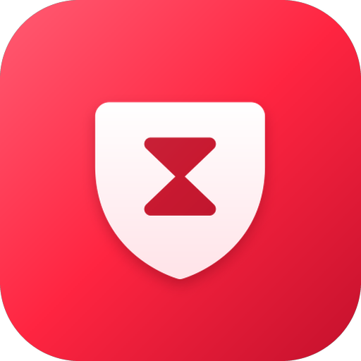

<div align="center">



# Align

**Smart screen time boundaries, deep focus timers, and mindful digital wellbeing.**  
*Native Android · 100% Jetpack Compose · Zero Accessibility Abuse · Pure Offline Privacy*

<br/>

[](https://github.com/RD7890/Align/actions)
[](https://github.com/RD7890/Align/releases/latest)
[](https://github.com/RD7890/Align/releases)
[](https://developer.android.com/about/versions/oreo)
[](LICENSE)
[](https://kotlinlang.org)
[](https://developer.android.com/jetpack/compose)

</div>

---

## 📲 Download & Installation

> **Latest Official Release:** [Align on GitHub Releases](https://github.com/RD7890/Align/releases/latest)

* **Direct APK Download**: Grab the signed `Align-v*.apk` directly from Releases.
* **Continuous Updates**: Every push to `main` verifies and signs a production APK automatically.
* **100% Offline & Private**: Zero analytics, zero telemetry, zero account required.

### Quick Setup:
1. Download `Align-v*.apk` from the latest release.
2. Enable **"Install unknown apps"** in your device settings.
3. Open Align and grant **Usage access** and **Display over other apps**.

---

## ⚡ Core Highlights

### ⏱️ Deep Focus Sessions
* **Preset & Custom Timers**: Quick-start 15, 25, 45, or 60-minute sessions, or customize from 5 to 180 minutes.
* **Category Auto-Targeting**: Block distracting apps by category (Social, Video, Games, News) or cherry-pick individually.
* **Anti-Cheat Lockout**: Settings, theme, and limit modifications are locked while a session is active.
* **Intentional Break Protection**: Sessions can only be cancelled with a dedicated 2.5-second hold gesture.
* **Pomodoro Mode**: Switch *Timer | Pomodoro* on the Home tab. Default 25 min focus / 5 min break, a long break after the last round (all editable, 1-8 rounds). Apps are blocked during focus and free during breaks, and the cycle keeps running even when the app is closed. Auto-continue can be turned off to start every phase by hand.
* **First-Run Setup**: Three screens on the first launch: what Align is and why it exists, the permissions it needs asked one at a time (usage access, battery, notifications, display over other apps, auto-start), and a closing note, followed by a thank-you toast. Existing users skip it.
* **App Folders**: On start Align creates its own `Android/data/com.align.app`, `Android/obb/com.align.app` and `Android/media/com.align.app` folders (app-specific storage, no permission needed) for future features.
* **Safe Exit**: Press back twice to leave the app. Closing the screen never stops the monitor or its foreground notification.
* **Fast Startup**: The splash screen is used for loading: the 7-day usage stats, chart data, app icons and labels are prepared behind it (the logo waits for them, up to 5 s), so the Stats tab opens with data in place. R8 and a baseline profile keep the release build smooth.
* **Calm Focus Ring**: One thin solid ring that fills as time passes (green during breaks), round dots for Pomodoro progress (they pop out of the ring when you switch to Pomodoro and glide back in when you return), and digits that roll smoothly whenever a number changes. Nothing glows or pulses while you focus.

### 🛡️ Non-Invasive System Overlay
* **Zero Accessibility Service Abuse**: Avoids battery-draining and security-sensitive accessibility services.
* **Native WindowManager Overlay**: Displays a smooth, full-screen `TYPE_APPLICATION_OVERLAY` sheet directly over blocked apps.
* **True Process Dismissal**: Tapping "Close" returns to Align and cleanly terminates the target app's background task.

### 📊 Real-Time Screen Time Insights
* **Interactive Donut Breakdown**: Instant visualization of today’s usage proportion per application.
* **7-Day Trend Charts**: Compare daily screen time against historical weekly averages.
* **Hour-by-Hour Breakdown**: Tap any individual app to view peak usage hours, daily limits, and remaining allowance.
* **Smart Throttled Refreshing**: Charts only re-render when timestamps shift, preventing jitter and battery drain.

### 📱 Adaptive Home Screen Widget
* **Universal Resizing**: Responsive single widget adapting dynamically from compact 1-row strips (4x1) up to full-screen blocks.
* **Auto-Flipping Views**: Smoothly cycles between Today's total, 7-Day bars, and Active Limits every 6.5 seconds.
* **Pixel-Density Scaled**: Rendered off-thread directly at your launcher's exact pixel dimensions.

### 🎨 Glassmorphic Material 3 Interface
* **Phosphor Vector Icons**: Custom-crafted native Android vector drawables across all navigation controls.
* **Fluid Floating Nav Bar**: Floating pill bottom bar with smooth spring animations.
* **Theme Support**: Seamless System Default, True Dark, and Light theme modes.
* **Animated Splash & Typography**: Seamless cold-start splash transitions powered by custom font rendering.

### 🔋 OEM Background Guard
* **Vendor Auto-Start Integration**: Direct shortcuts into proprietary autostart managers (Xiaomi, OnePlus, Samsung, Oppo, Vivo, Huawei).
* **Watchdog Protection**: Scheduled watchdog alarm (`RestartReceiver`) keeps monitoring active without background crashes.

---

## 🏗️ Architecture & Structure

```
com.align.app
├── data/
│   ├── AppCache.kt         — Background async app label & icon cache
│   ├── AppHelper.kt        — Installed apps, package categories & intent resolver
│   ├── Illustrations.kt    — SVG vector illustration rendering pipeline
│   └── LimitStore.kt       — JSON persistence for limits, themes, focus & pomodoro state
├── service/
│   ├── AutoStartHelper.kt  — OEM background battery & autostart dispatchers
│   ├── BlockOverlay.kt     — Full-screen WindowManager overlay with spring sheets
│   ├── BootReceiver.kt     — System boot-completed listener
│   ├── PomodoroEngine.kt   — Pomodoro phase state machine shared by UI & service
│   ├── MonitorService.kt   — Foreground usage polling service & watchdog
│   └── RestartReceiver.kt  — Periodic alarm-based service persistence
├── ui/
│   ├── AppDetailScreen.kt  — Per-app breakdown, limits & hourly histograms
│   ├── Charts.kt           — Canvas-rendered donut charts, focus ring & 7-day bar charts
│   ├── Components.kt       — Custom FgSlider, buttons, cards & floating bottom nav
│   ├── FocusScreen.kt      — Timer / Pomodoro modes, focus ring & hold-to-cancel
│   ├── ThemeReveal.kt      — Circular theme-change reveal (screenshot + growing hole)
│   ├── Onboarding.kt       — First-run about / permissions / final-note screens
│   ├── MainScreen.kt       — Central hub coordinating navigation, tabs & permissions
│   ├── SettingsScreens.kt  — Category-based app blocker & theme selector
│   ├── Splash.kt           — Canvas splash with radial reveal transitions
│   └── Theme.kt            — Material 3 palette, typography & colors
└── widget/
    ├── WidgetData.kt       — Widget payload snapshot generator
    ├── WidgetProviders.kt  — AppWidgetProvider with async refresh triggers
    └── WidgetRenderer.kt   — High-DPI canvas renderer with compact strip support
```

---

## 🔄 How Usage Monitoring Works

```
UsageStatsManager Events (every 2 seconds)
        │
        ▼
Is Foreground App in Blocklist / Focus List?
        ├── NO  ──► Continue monitoring (silent loop)
        │
        └── YES ──► Has Daily Limit Exceeded OR Focus Active?
                     │
                     ▼
             WindowManager.addView()
                     │
                     ├─ Display Glassmorphic "Time's Up" Overlay
                     ├─ Slide-up Sheet Animation
                     └─ User taps Close ──► Redirect & terminate process
```

---

## 🔒 Fork-Safe Automated CI/CD

Align uses two isolated, hardened GitHub Actions workflows that share one build action:

```
Build  (push / PR / manual)              Release  (manual: Actions ► Release ► Run workflow)
     │                                        │
     ├─ Restore cached Gradle deps            ├─ Validate version + tag (no duplicates)
     ├─ Read signing secrets (never on PRs)   ├─ Read SIGNING_KEYSTORE_B64, KEYSTORE_PASSWORD,
     │   └─ none? ► throwaway key             │   KEY_ALIAS from Secrets (fails if missing)
     ├─ Stamp dev version (x.y.z-dev.N)       ├─ Stamp your version + versionCode
     ├─ Build Release APK                     ├─ Build Release APK + verify with apksigner
     ├─ Verify APK signature                  ├─ Create tag + GitHub Release (APK + .sha256)
     ├─ Upload APK artifact (14 days)         └─ Custom title, notes, pre-release, draft
     └─ Clean up ephemeral signing files
```

**Cutting a release:** *Actions ► Release ► Run workflow*, then fill in `version` (e.g. `1.0.4`), and optionally `tag`,
`title`, `notes`, `prerelease` and `draft`. Notes come from the `notes` input, else `release-notes/<version>.md`
if it exists, plus an auto-generated changelog. `versionCode` is derived from the version
(`MAJOR×10,000,000 + MINOR×100,000 + PATCH×1,000`), so it always increases.

> **Security Note:** The official release key is never committed to Git. If the repository is forked, the Build workflow automatically detects missing secrets and generates an isolated throwaway key, and the Release workflow refuses to run without the real key—ensuring forks cannot sign binaries impersonating the official release.

---

## 🛠️ Local Build Instructions

**Requirements:** Android Studio Jellyfish+, JDK 17+, Android SDK Platform 35.

```bash
# Clone the repository
git clone https://github.com/RD7890/Align.git
cd Align

# Build debug APK
./gradlew :app:assembleDebug

# Output APK path:
# app/build/outputs/apk/debug/app-debug.apk
```

To build a signed release locally, add your keystore credentials into your local git-ignored `local.properties`:
```properties
signing.storeFile=/path/to/your-key.jks
signing.storePassword=your-password
signing.keyAlias=your-alias
signing.keyPassword=your-password
```

---

## 📦 Technology Stack

* **Language**: Kotlin 2.0.21
* **UI Toolkit**: Jetpack Compose (BOM 2024.10.01)
* **Architecture Components**: ViewModel, Coroutines, StateFlow, AndroidX Lifecycle
* **Graphics & Icons**: Phosphor Icons (MIT), unDraw SVG (AndroidSVG 1.4)
* **Build System**: Gradle 8.10.2 + Android Gradle Plugin 8.7.2
* **Compatibility**: Android 8.0 (API Level 26) through Android 15 (API Level 35)

---

## 📄 License

Distributed under the **GNU General Public License v3.0 (GPL-3.0)**. Strong copyleft guarantees that Align remains free and open-source forever; any forks or modifications must also be released under the same open-source terms.

```text
Align — Copyright (C) 2026 RD7890
This program is free software: you can redistribute it and/or modify
it under the terms of the GNU General Public License as published by
the Free Software Foundation, either version 3 of the License, or
(at your option) any later version.
```

See the [LICENSE](LICENSE) file for the full legal text.

<div align="center">

**Align** — Take back control of your screen time.  
*Crafted with precision using modern Android Jetpack Compose.*

</div>
